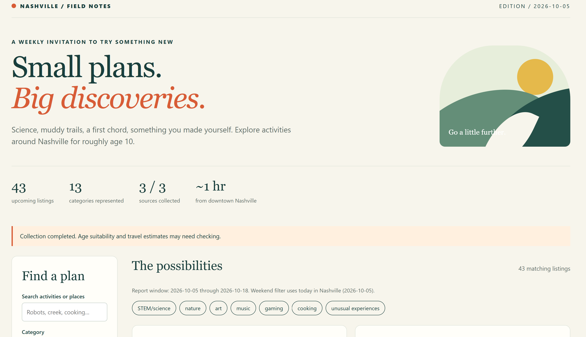
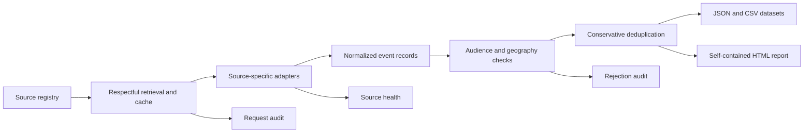

# Nashville Events Pipeline

A local Python pipeline that discovers, normalizes, validates, and reports public activities around Middle Tennessee.

## Why I Built It

I wanted a better way to find new experiences for my 10-year-old stepson around Nashville. Ordinary searches repeatedly surfaced the same familiar activities, while science programs, nature events, workshops, performances, volunteer opportunities, sports, and unusual local experiences were scattered across dozens of unrelated calendars.

That personal need became an analytical question:

> How can I consistently discover a wider variety of worthwhile activities without manually checking the same collection of websites every week?

The project grew from source research into a tested data pipeline. Its purpose is to expand opportunity, not measure the child: it stores public event information and does not create child profiles or track preferences, attendance, ratings, or engagement.

## Dashboard Preview

These screenshots show a point-in-time demonstration run covering three sources and a 14-day event window. The larger figures in [Verified Evidence](#verified-evidence) come from a separate saved validation run across the project's 12 configured collectors.



*Dashboard overview with the report window, collection status, headline metrics, and activity categories.*


*Filterable results with source links, estimated travel, missing-data indicators, and verification warnings.*

## What It Does

The pipeline:

- Maintains a researched registry of 53 local and regional sources
- Has configured collectors for 12 sources using public APIs, calendar feeds, sports schedules, and bounded page adapters
- Normalizes inconsistent dates, locations, categories, age evidence, prices, and registration details
- Rejects explicit age mismatches, cancellations, closures, remote-only events, and out-of-window records
- Deduplicates conservatively while preserving official-source provenance
- Records source health, rejection reasons, requests, and run manifests
- Supports cached offline replay for repeatable debugging
- Generates JSON, CSV, and a self-contained local HTML report

## Architecture



## Verified Evidence

A saved September 19, 2026 run processed:

| Measure | Result |
|---|---:|
| Sources researched | 53 |
| Configured collectors | 12 |
| Raw records | 1,058 |
| Final event records | 870 |
| Rejected records with reasons | 187 |
| Events from official sources | 333 |
| Pipeline tests | 11 passing |

The saved run is historical evidence, not current event availability. See [the complete case study](docs/CASE_STUDY.md) and [verified evidence snapshot](docs/evidence_snapshot.json).

## Run Locally

Requirements:

- Python 3.11 or newer
- Internet access for a fresh collection
- Windows PowerShell for the convenience launcher, or any shell for direct Python execution

### Windows launcher

From PowerShell:

```powershell
.\Run.ps1
```

From Git Bash:

```bash
powershell.exe -NoProfile -ExecutionPolicy Bypass -File ./Run.ps1
```

The first launcher run creates `.venv`, installs pinned dependencies, collects events, and writes `report.html` plus supporting files under `data/`. A fresh collection can take several minutes because source crawl delays are honored.

Launcher exit codes:

- `0` - all enabled collectors completed without warnings
- `2` - the report was created, but one or more sources had a visible coverage warning
- `1` - the collection failed or every selected source failed
- `3` - another run or a leftover lock prevented startup

Code `2` is a usable report, not a failed installation. Open the report's **Source Health** section to see the gaps.

### Direct setup from PowerShell

```powershell
python -m venv .venv
.\.venv\Scripts\python.exe -m pip install -r requirements.txt
.\.venv\Scripts\python.exe -m unittest discover -s tests -v
```

### Direct setup from Git Bash on Windows

```bash
python -m venv .venv
./.venv/Scripts/python.exe -m pip install -r requirements.txt
./.venv/Scripts/python.exe -m unittest discover -s tests -v
```

### Direct setup from macOS or Linux

```bash
python3 -m venv .venv
./.venv/bin/python -m pip install -r requirements.txt
./.venv/bin/python -m unittest discover -s tests -v
```

Running the tests first confirms that the environment is ready without making network requests.

### Collect events

PowerShell:

```powershell
# Limit the collection window and source set
.\.venv\Scripts\python.exe -m nashville_weekly --days 14 --sources warner,gamepoint,discovery

# Write generated data and the report somewhere else
.\.venv\Scripts\python.exe -m nashville_weekly --output .\local-output
```

Git Bash on Windows:

```bash
./.venv/Scripts/python.exe -m nashville_weekly --days 14 --sources warner,gamepoint,discovery
```

macOS or Linux:

```bash
./.venv/bin/python -m nashville_weekly --days 14 --sources warner,gamepoint,discovery
```

Offline replay requires a previously populated local cache for the same date window. Caches and generated runs are intentionally excluded from this repository.

## Run Tests

PowerShell:

```powershell
.\.venv\Scripts\python.exe -m unittest discover -s tests -v
```

Git Bash on Windows:

```bash
./.venv/Scripts/python.exe -m unittest discover -s tests -v
```

The tests cover pagination, recurring calendar exceptions, feed limits, age rules, cancellations, timezone conversion, geography, deduplication, false-free prevention, and URL safety.

## Trust Rules

The project favors honest uncertainty over inflated coverage:

- Missing age evidence remains visibly unknown.
- “Family” wording is not proof of eligibility.
- “Free parking” does not make an event free.
- HTTP success does not prove a calendar is complete.
- City-center travel estimates are labeled as heuristics, not exact routes.
- Blocked or booking-only sources remain documented manual leads rather than being bypassed.

See [source discovery](docs/SOURCE_DISCOVERY.md) for the full research record.

## Repository Map

```text
config/             source registry and public-reference settings
docs/               case study, source research, and verified evidence
nashville_weekly/   collection, normalization, quality, and report code
tests/              deterministic transformation and adapter tests
Run.ps1             Windows setup and execution helper
```

Generated event data, response caches, run history, logs, and local environments are excluded from version control.

## Limitations

- Source coverage is broad but not exhaustive.
- Age and category extraction are heuristic.
- Travel estimates are not live routing or traffic estimates.
- Some enabled sources provide only bounded first-page coverage.
- Source websites can change without notice.
- The report supports discovery; users must confirm current details with the original source before attending.

## Project Documentation

- [Full analytical case study](docs/CASE_STUDY.md)
- [Verified evidence snapshot](docs/evidence_snapshot.json)

